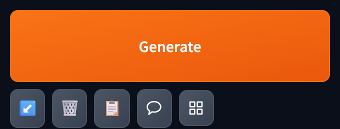
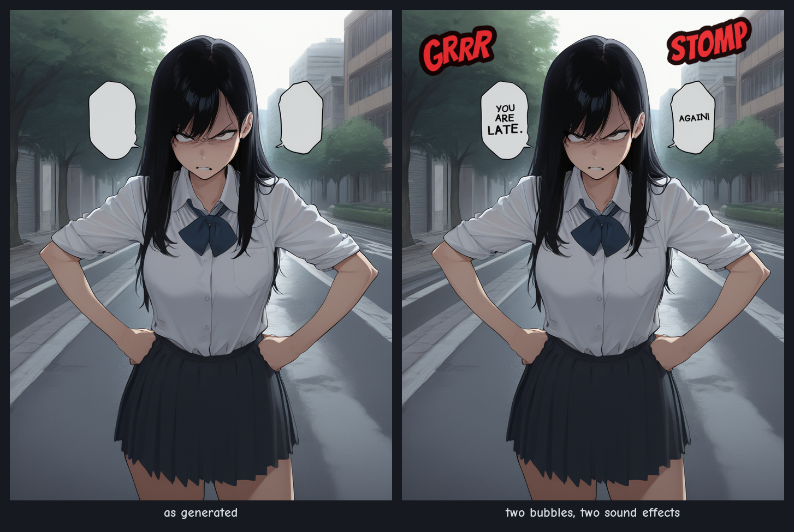
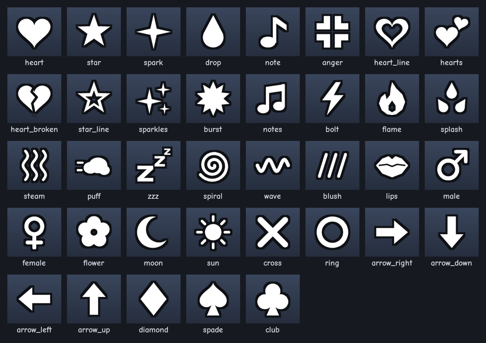
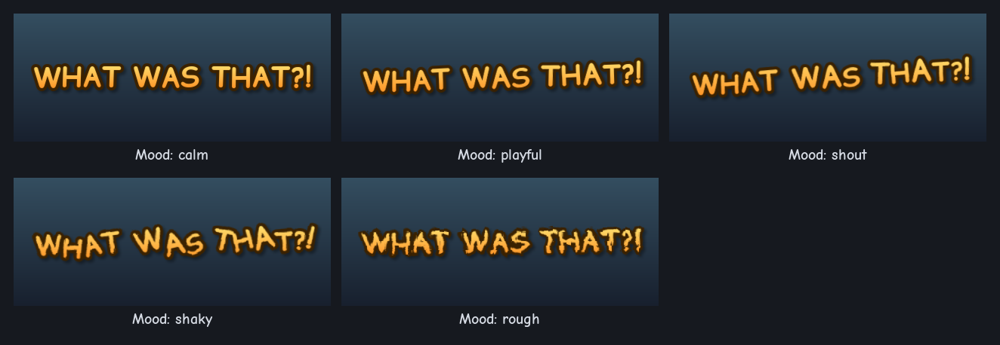
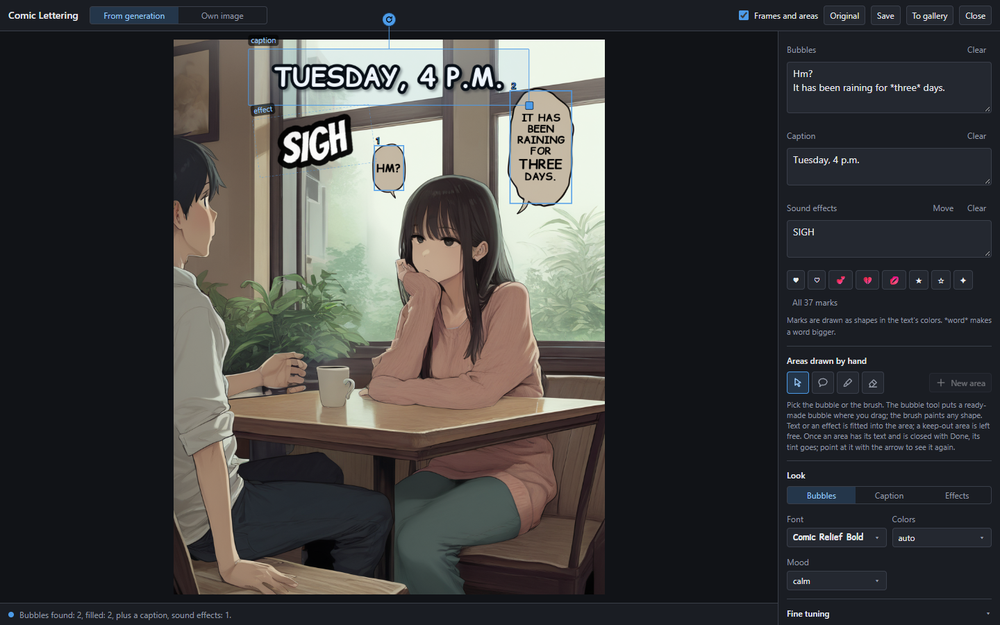
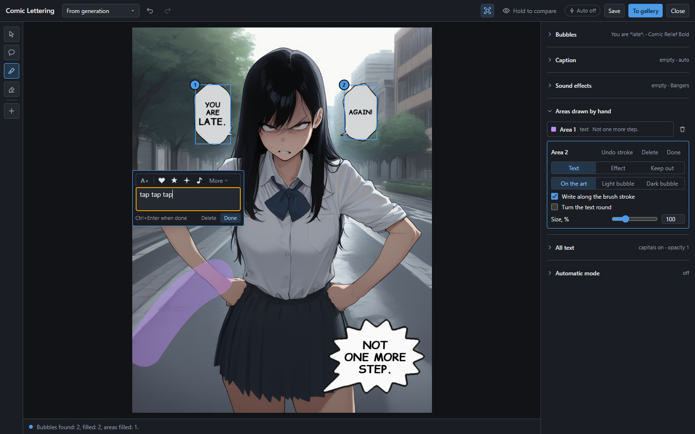
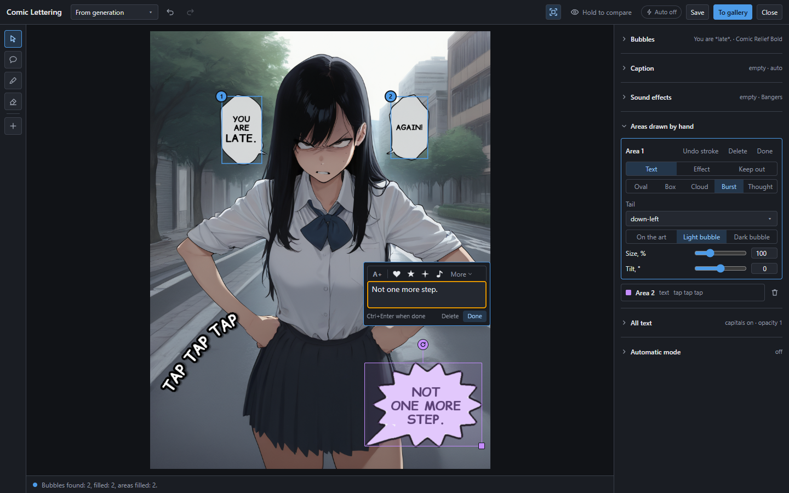
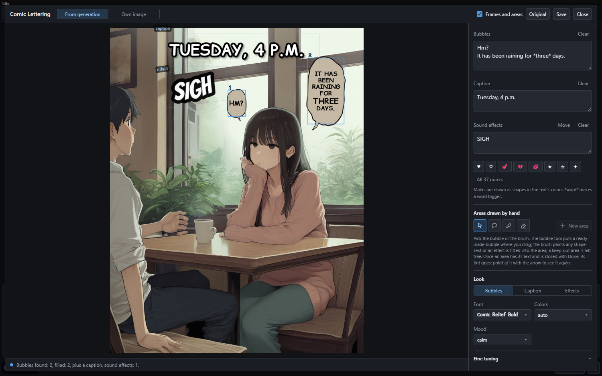

# Comic Lettering

**Put your own words on a generated image, without opening an image editor.**

Image models draw speech bubbles full of gibberish. Comic Lettering finds those bubbles, wipes them clean and fits your text inside. It also draws captions and sound effects straight onto the art, and lets you add bubbles of your own where the model drew none.

One repository, two hosts: an **extension for AUTOMATIC1111 / Forge / reForge** and a **custom node for ComfyUI**, with the same editor in both.


## Contents

- [What it does](#what-it-does)
- [Requirements](#requirements)
- [Install](#install)
- [Quick start](#quick-start)
- [The editor](#the-editor)
- [Writing the text](#writing-the-text)
- [The look](#the-look)
- [Placing things by hand](#placing-things-by-hand)
- [Bubbles and areas of your own](#bubbles-and-areas-of-your-own)
- [Saving](#saving)
- [Lettering every image automatically](#lettering-every-image-automatically)
- [Keeping text off the characters](#keeping-text-off-the-characters)
- [ComfyUI](#comfyui)
- [Fine tuning](#fine-tuning)
- [Fonts](#fonts)
- [Limits](#limits)
- [Troubleshooting](#troubleshooting)
- [For developers](#for-developers)
- [License](#license)

## What it does

| | |
|---|---|
| **Fills the bubbles in the art** | Empty or gibberish bubbles are found, erased and filled, each line at the largest size that fits. |
| **Captions** | Text straight on the art with an outline and a shadow, or inside a bubble drawn for it. A free, calm spot is chosen automatically. |
| **Sound effects** | `STOMP`, `THUD x3`: big, tilted, outlined words placed in the empty parts of the picture. |
| **Bubbles of your own** | Five ready-made shapes with tails, or any shape you paint with a brush. |
| **Text along a line** | Paint one brush stroke and the words follow its curve. |
| **37 marks** | Hearts, stars, sparks, notes, anger marks and more, drawn as shapes so they work in every font. |
| **Hand placement** | Drag, resize and turn captions, effects and your own areas on the image. |
| **A look per kind of text** | Font, color preset, mood and decoration, separately for bubbles, captions and effects. |
| **Automatic mode** | Letter every image during generation, with no clicks at all. |

## Requirements

| | |
|---|---|
| Host | AUTOMATIC1111, Forge or reForge; or ComfyUI |
| Python packages | `numpy`, `scipy`, `Pillow` 9.2 or newer. Both hosts already ship them: nothing is installed. |
| Node.js | Not needed. The editor is shipped built. |
| Optional | `ultralytics` and a person segmentation model, so automatic placement keeps off the characters. See [Keeping text off the characters](#keeping-text-off-the-characters). |

## Install

**AUTOMATIC1111 / Forge / reForge.** Open `Extensions` → `Install from URL`, paste the address below and press `Install`. Then restart the web UI.

```
https://github.com/KazeKaze93/sd-comic-lettering
```

Or from a terminal:

```
cd extensions
git clone https://github.com/KazeKaze93/sd-comic-lettering.git
```

**ComfyUI.**

```
cd ComfyUI/custom_nodes
git clone https://github.com/KazeKaze93/sd-comic-lettering.git
```

Restart ComfyUI. The node is `Comic Lettering`, in the category `image/postprocessing`.

**Update** either one with `git pull` in the `sd-comic-lettering` folder, then restart the host and refresh the browser page.

## Quick start

For AUTOMATIC1111 / Forge / reForge. ComfyUI has [its own section](#comfyui).

1. Generate an image. Asking for `speech bubble` in the prompt gives the script bubbles to fill.
2. Press the **speech-bubble icon** in the row of small tool buttons under `Generate`. The editor opens over the page with the image from the gallery.

   

   The last icon in the picture is Style Grid's, shown when that extension is installed.
3. Type into `Bubbles`, one line per bubble. The numbers on the image show which bubble takes which line.
4. Press `To gallery` to put the result into the gallery, or `Save` to write it to disk.

Everything applies by itself: a list or a checkbox when it changes, a slider when you let go of it, a text field when you leave it or press Ctrl+Enter. There is no "Apply" button.


## The editor

**Top bar**

| Control | What it does |
|---|---|
| `From generation` / `Own image` | Which image is lettered: the one in the gallery of the tab you came from, or a file of yours. Drop a file onto the editor or click to choose one; nothing has to be generated for that. |
| `Place all automatically` | Appears once something was moved by hand. Hands every item back to automatic placement. |
| `Frames and areas` | Shows or hides the outlines over the image: every bubble found, numbered in reading order, and a frame around each caption, effect and area. Untick it to see the image exactly as it will be saved. |
| `Original` | Shows the image without the lettering. The texts stay in their fields. |
| `Save` | Writes the lettered image to disk. See [Saving](#saving). |
| `To gallery` | Puts the lettered image into the host's gallery and closes the editor. |
| `Close` | Closes the editor. Esc does the same. |

**The image.** Blue frames mark what the script found and drew. Dashed frames are bubbles left empty. The status line under the image says how many bubbles were found and filled, and warns when character detection is off.

**The side panel**, from top to bottom: the three text fields, the mark buttons, the drawing tools with a card per area, the look, and fine tuning.


## Writing the text

There are three fields.

| Field | What goes in |
|---|---|
| **Bubbles** | One line per bubble, in reading order: top to bottom, left to right. An empty line skips a bubble. Line breaks inside a bubble are chosen for you, at the largest font size that fits, with short lines at the top and bottom and long ones in the middle. |
| **Caption** | Text outside the bubbles: straight on the art, or in a bubble drawn for it (`Look` → `Caption` → `Put in a bubble`). |
| **Sound effects** | One per line. Each is drawn big, tilted and outlined in a calm, empty part of the art, clear of the bubbles, the characters, the caption and the other effects. `THUD x3` stacks the word three times in a ragged column. `Move` sends them all somewhere else. |

In any field:

- `*word*` makes a word bigger.
- A mark button inserts a mark at the cursor of the field you used last.
- A word may break after a hyphen you typed (`H-m-m`) when that lets the text be bigger.



**When a line does not fit.** A line goes into a bubble only if it fits at a readable size in at most eight lines. In a bubble too tight for an emphasised word, the emphasis is dropped first; then the longest words are broken with a hyphen (`UNBE-` / `LIEVABLE`). A line that still does not fit is added to the caption, and the next line gets that bubble. To always write into the bubbles, however small, untick `Text too long for a bubble goes to the caption` under `Fine tuning`.

### Marks

Comic fonts have no hearts or stars, so marks are drawn as shapes, in the colors of the text they stand in. The panel shows eight of them; `All 37 marks` shows the rest.



Typing the character works as well as pressing its button: `♥` (or `<3`) `♡` `💕` `💔` `💋` `★` `☆` `✦` `✨` `💥` `💢` `⚡` `🔥` `💧` `💦` `♨` `💨` `〃` `〰` `🌀` `💤` `♪` `♫` `✿` `🌙` `☀` `♂` `♀` `✖` `○` `→` `←` `↑` `↓` `♦` `♠` `♣`.

## The look

Bubbles, the caption and sound effects each have a look of their own. The `Look` switch chooses whose lists are shown.

| List | What it does |
|---|---|
| **Font** | Every entry of the list is shown in its own font. The caption can use the bubble font or one of its own. |
| **Colors** | A preset: fill, outline, and where it suits, a second outline, a gradient or a glow. `auto` is white with a dark outline (black inside a light bubble). `from the art` takes the strongest color of the image. `custom` uses the colors typed under `Fine tuning`. |
| **Mood** | How unruly the letters are, from `calm` to `shaky`. `custom` uses the sliders under `Fine tuning`. |
| **Marks around** | Small marks scattered around a caption or an effect. |





The caption has a few more lists:

| List | What it does |
|---|---|
| **Position** | `auto`, `top`, `bottom`, `center` or a corner. With `auto` the script tries a band at the top or bottom, then a block in a corner, then the same a little smaller, and takes the first that is clear of bubbles and characters. |
| **Put in a bubble** | Draws a bubble for the caption: `oval`, `box`, `cloud` or `burst`. |
| **Bubble color** | `light`: white with a dark outline. `dark`: black, with the outline and text in the chosen colors. |
| **Tail** | Which way the tail points, or none. |

The last two appear once a bubble shape is chosen.

## Placing things by hand

The caption, its drawn bubble and every sound effect can be moved on the image.

- **Drag** a frame to move it.
- **Click** a frame to pick it. The square at its corner resizes it; the round knob on a stem above it turns it.
- **Arrow keys** nudge the picked item by one pixel, by ten with Shift.
- `Place automatically` under a picked frame, or Delete, hands that item back to the script.



What you placed stays where it is when the texts or the look change, and everything placed automatically keeps off it. Texts inside bubbles found in the art are always fitted by the script.

## Bubbles and areas of your own

When the model drew no bubble where you need one, make it yourself. Under `Areas drawn by hand` there are four tools:

| Tool | What it does |
|---|---|
| **Arrow** | Draws nothing. Drag areas, captions and effects; click an area to edit its text and see its handles. |
| **Bubble** | Puts a ready-made bubble on the image. |
| **Brush** | Paints an area of any shape. A slider sets the width, a ring on the image shows it. |
| **Eraser** | Rubs out whatever it passes over, in every area. |

### Ready-made bubbles

Choose a shape, a tail (eight directions, or none) and light or dark, then drag on the image where the bubble goes. A click alone puts down one of a handy size.


A field for the text opens right beside the bubble. Type, then press `Done` or Ctrl+Enter: the bubble is painted and the text is fitted inside.


### Painted areas

With the brush, paint the place where text should go; a text field opens beside it in the same way. Paint that touches the picked area adds to it. Paint anywhere else starts a new area, so two bubbles are two areas with a text each. `New area` starts one even on top of the picked one.

**Text along a stroke.** An area made of a single brush stroke starts with `Write along the brush stroke` on: the words run along the stroke and bend with it, in the direction you drew it, with letters about as tall as the brush is wide. Paint one stroke along a contour to set a word on it. `Turn the text round` runs it the other way.



### What an area can be

Every area has a card in the panel.

| Kind | What happens in it |
|---|---|
| `Text` | The text is fitted into the area as large as its shape allows. `On the art` draws it with the caption's outline; `Light bubble` and `Dark bubble` paint the area as a bubble first, so any shape you paint becomes a bubble. |
| `Effect` | The text is one sound effect, sized to the area and put in its middle. |
| `Keep out` | Nothing the script places lands there. Use it to protect a face or a detail. |

The card also has `Size` (how large the text is against what the area gives it; above 100% it may reach out of the area), `Tilt`, `Undo` (takes back the last thing drawn there) and `Delete`. A bubble made from a template can still change its shape and tail there.

With the arrow, click an area to bring up its text field and handles: the corner square makes the area larger or smaller about its middle, the knob on the stem turns it, and the text inside turns and resizes with it. A drag moves the area with everything in it.



An area's tint shows only while you work on it. Once it has its text and the field is closed, the tint goes; pointing at the area with the arrow brings it back, and the eraser shows every area.


Areas and everything placed by hand belong to the image they were made on. They stay when the editor is closed and opened again on the same image, and go with the next generation.

## Saving

- **`Save`** saves the lettered image the way the host saves its own images of that tab: same folder, file name pattern, numbering, format and subfolders, with `-lettered` at the end of the name and the generation parameters kept. The status line names the file.
- **`To gallery`** shows the result in the gallery of the tab you came from and closes the editor. From there the host's own buttons (save, send to img2img, send to extras) work on it as on any image.

The look is remembered between sessions in `user_settings.json` in the extension folder.

## Lettering every image automatically

Tick `Letter every new image while it is generated` at the bottom of the panel. From then on every image a generation makes is lettered with the three texts and the look as they stand in the editor, and arrives in the gallery already lettered. The editor can still be opened on it: it works from the clean copy.

Areas and hand placement are not part of this mode: they belong to one image.

## Keeping text off the characters

Text that is placed automatically (sound effects, and the caption with `auto` position) avoids the characters when two things are present on the machine:

- the `ultralytics` Python package (ADetailer installs it), and
- a person segmentation model named `person_yolov8*-seg.pt`.

The model is looked for in `models/adetailer`, `models/ultralytics/segm`, a StabilityMatrix `Models/Ultralytics/segm` folder and a sibling ComfyUI install. The `SDCL_PERSON_MODEL` environment variable can point at any other file. **Nothing is downloaded.**

Without them the status line says so, and placement goes by calm areas alone, which often means on a character. Use a `Keep out` area or drag the item in that case.

## ComfyUI

Add the `Comic Lettering` node (category `image/postprocessing`) between `VAE Decode` and `Save Image`. Its widgets are the three texts and the whole look, and it letters every image that passes through it.


The node has the same editor, behind the `Open editor` button at the bottom of the node:

1. Run the workflow once, so the node has seen an image.
2. Press `Open editor`. The editor opens over ComfyUI with that image, as it came into the node.
3. Work as described above: texts, look, dragging, bubbles, areas.
4. Run the workflow again: it gives the picture the editor showed.



What differs from the web UI family:

| | |
|---|---|
| **The node is the memory** | Every change in the editor is written back into the node: texts and look into its widgets, hand placement and areas into a hidden `layout` field. The workflow file carries everything; `user_settings.json` is not used. |
| **`Save`** | Writes the picture into ComfyUI's output folder straight away, as `ComfyUI_lettered_00001_.png` and so on. |
| **No `To gallery`, no automatic mode** | The node letters every run by itself. |
| **Random seeds** | Hand placement and areas are kept as positions on the image: with a new seed the next image gets them in the same places. |
| **Batches** | The editor shows the first image; the layout goes onto all of them. |
| **`show_numbers`** | A node-only switch: draws each bubble's number instead of text, to see the reading order without opening the editor. |

## Fine tuning

`Fine tuning` at the bottom of the panel opens the sliders, grouped by kind of text. `Reset the look` puts everything back; `Keep the fonts` leaves the three fonts alone.

| Group | Option | What it does |
|---|---|---|
| All text | `Capital letters` | Comic-style capitals. |
| | `Soften the edges` | A slight blur that blends the letters with the art. |
| | `Uneven ink` | Makes the fill patchy. |
| | `Bend into an arc`, `Tilt` | Bend and tilt of the whole block. |
| | `Opacity` | Transparency of the text. |
| Bubbles | `Erase the letters the model drew` | Wipes a bubble clean before writing. |
| | `Text too long for a bubble goes to the caption` | See [When a line does not fit](#writing-the-text). |
| | `Largest font` | The largest size tried in a bubble, % of image height. |
| | `Smallest readable font` | Below this a line counts as not fitting. |
| | `Gap to the bubble edge` | Room between the text and the outline. |
| | `Darkest fill still seen as a bubble` | Default 120. Raise it if a gray object gets lettered; lower it for dim bubbles. |
| Caption | `Font size`, `Outline width`, `Shadow` | Size (% of image height), outline and drop shadow. |
| | `Text color`, `Outline color` | `auto` or `#RRGGBB`. Used when `Colors` is `custom`. |
| Sound effects | `Font size`, `Largest tilt`, `Opacity` | Size, the largest random tilt, transparency. |
| | `Arrangement number` | Where the effects land. `Move` raises it by one. |
| | `Color` | `auto` or `#RRGGBB`. Used when `Colors` is `custom`. |
| Mood: custom | `Letters wobble`, `Letters differ in size`, `Ragged edges`, `Lines tilt`, `Lines shift sideways`, `Line spacing`, `Wobble pattern number` | The sliders behind the `custom` mood. |

## Fonts

Sixteen fonts ship in `fonts/bundled/`, taken from [google/fonts](https://github.com/google/fonts). Their licenses (SIL Open Font License 1.1 or Apache 2.0) are in `fonts/bundled/licenses/`.


Your own `.ttf` / `.otf` files go into `fonts/`: they are listed first and are git-ignored, so an update never touches them. A few comic-looking system fonts are listed last, when the system has them.

## Limits

- **What counts as a bubble.** A flat white, gray or lightly tinted (cream, beige) fill enclosed by a dark outline, or a flat near-black fill enclosed by a bright outline, with a smooth, nearly convex shape. Spiky or cloud-shaped bubbles, bubbles without an outline, translucent or gradient bubbles and rectangular caption boxes are not found. Use a ready-made bubble or a painted area for those.
- **False finds.** Anything that looks the same gets lettered too, such as a blank sheet of paper on a wall. The frames show what was found and number it: use an empty line to skip a number.
- **Narrow bubbles.** A narrow bubble cannot hold a long word at a readable size. Such text goes to the caption.
- **Crowded images.** When a character fills most of the frame there may be no free place. A drawn bubble is then tried tall and narrow, then shrunk, and put where it covers the least, keeping off heads and bubbles first. The head is taken to be the top quarter of a character, so this fails for a character lying down or upside down.
- **Fixed positions avoid nothing.** A caption set to `top` or a corner goes there whatever is underneath.
- **Sound effects.** A place is chosen for an estimated box, so a very wide font can make two effects touch.
- **No emoji font.** Only the 37 marks are drawn; any other emoji shows as the font's missing-character box.
- **One page at a time.** This is a lettering tool for single images, not a page layout tool: it does not make panels.

## Troubleshooting

| What you see | What to do |
|---|---|
| No speech-bubble icon under `Generate` | Restart the web UI after installing, then hard-refresh the page (Ctrl+F5). |
| `The gallery is empty: generate an image first.` | Generate an image, or switch to `Own image`. |
| `The image is gone from memory. Load it again.` | The server keeps the last six images. Close the editor and open it again on the image. |
| A bubble is not found | Lower `Darkest fill still seen as a bubble`, or put a ready-made bubble over it. |
| Something that is not a bubble gets text | Leave its line empty, or raise `Darkest fill still seen as a bubble`. |
| Text lands on a character | See [Keeping text off the characters](#keeping-text-off-the-characters), or drag it, or paint a `Keep out` area. |
| A `Light bubble` area is not painted | An area is painted once it has text and the field is closed with `Done` or Ctrl+Enter. |
| The editor looks old after an update | Hard-refresh the page (Ctrl+F5). |
| ComfyUI: `Open editor` shows no image | Run the workflow once first: the editor shows the image the node last received. |

## For developers

| Document | What is in it |
|---|---|
| [docs/ARCHITECTURE.md](docs/ARCHITECTURE.md) | The layers, the repository layout, how a render travels from a click to pixels. |
| [docs/CORE.md](docs/CORE.md) | The Python core: `letter()`, `arrange()`, `draw()`, the scene format, pins, regions, the CLI. |
| [docs/API.md](docs/API.md) | The HTTP routes and the messages between the host page and the editor. |
| [docs/DEVELOPMENT.md](docs/DEVELOPMENT.md) | Building the editor, running it without a host, conventions, how to add a mark, a color preset or an option. |

The core can be used on its own:

```python
from PIL import Image
from comic_lettering import Style, letter

image = Image.open("page.png")
result, info = letter(image, "Hi!\nYo.", caption="Last day of summer.", sfx="SPLASH",
                      style=Style(sfx_colors="ice"))
result.save("lettered.png")
```

Or from a terminal, in the repository folder:

```
python -m comic_lettering in.png out.png --text "Hi!\nYo." --caption "Last day of summer." --sfx SPLASH
```

## License

The code is licensed under the [GNU Affero General Public License v3.0](LICENSE).

The bundled fonts keep their own licenses (SIL Open Font License 1.1 or Apache 2.0), in `fonts/bundled/licenses/`. Images you letter with this tool are yours: the license covers the program, not its output.
