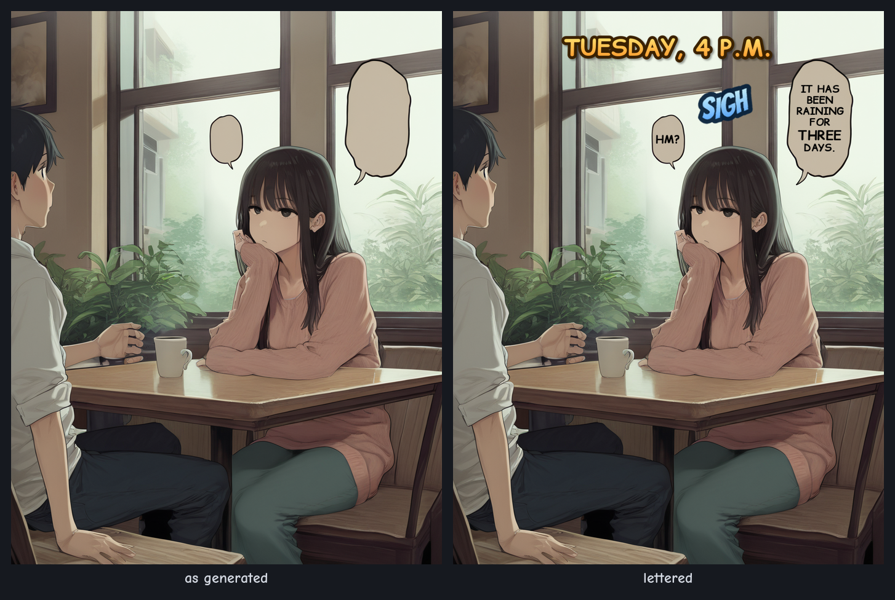
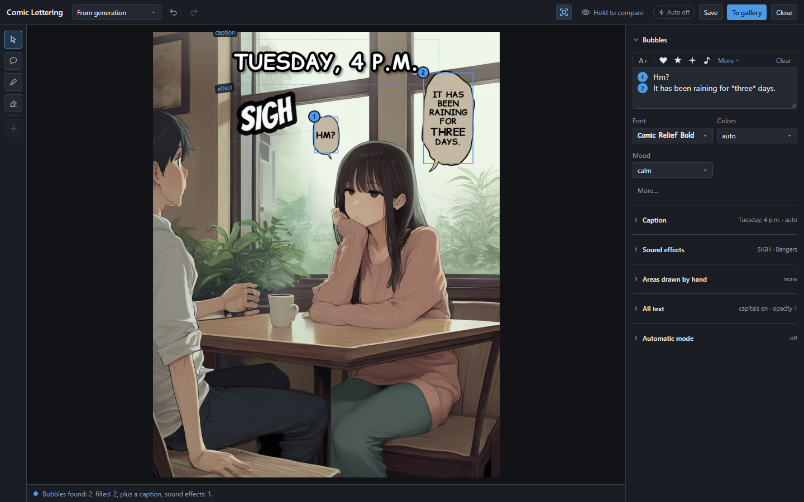
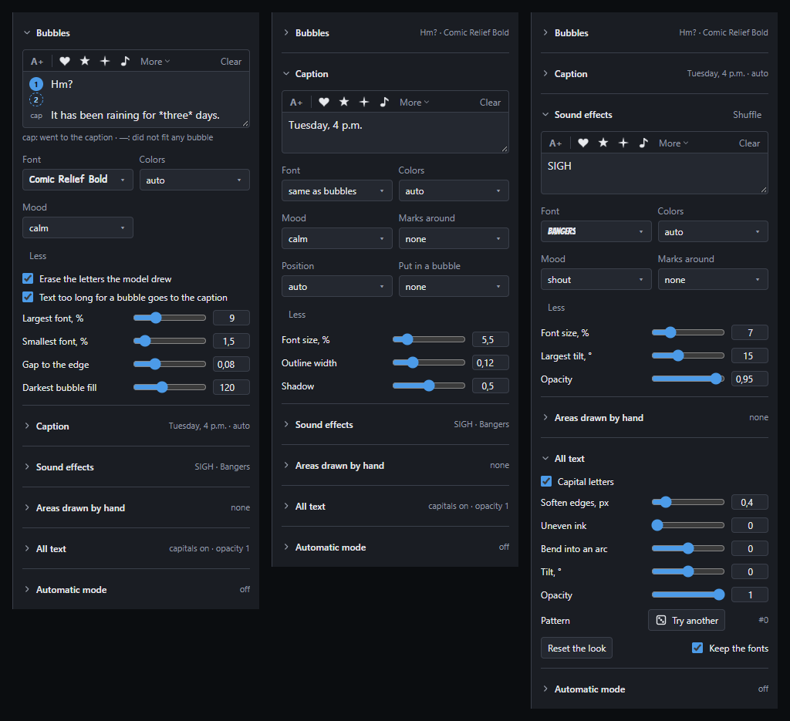
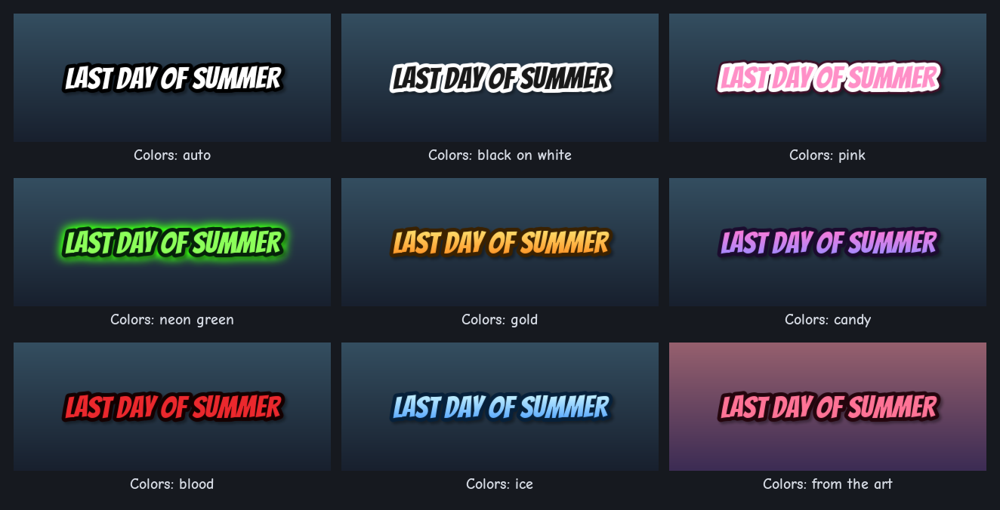
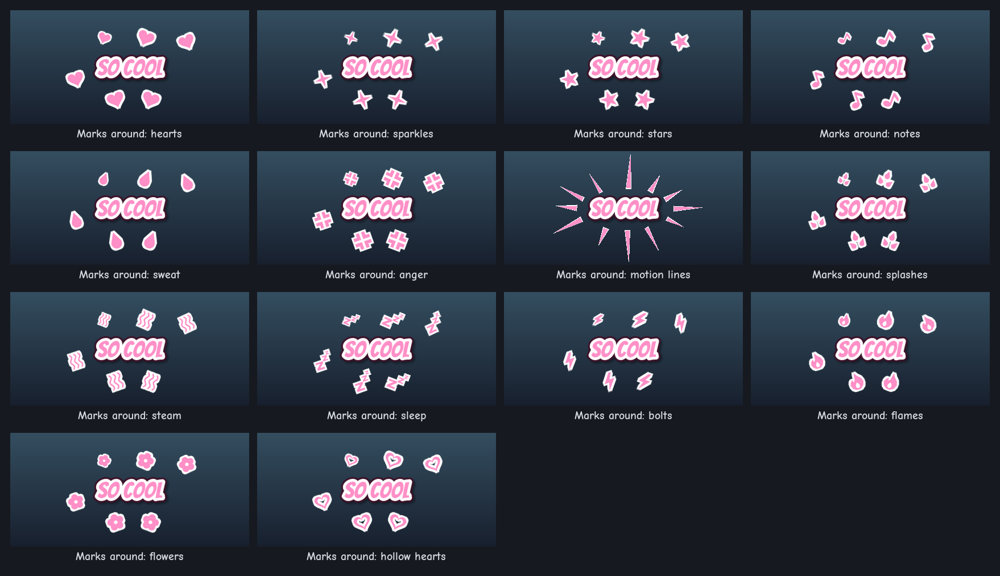
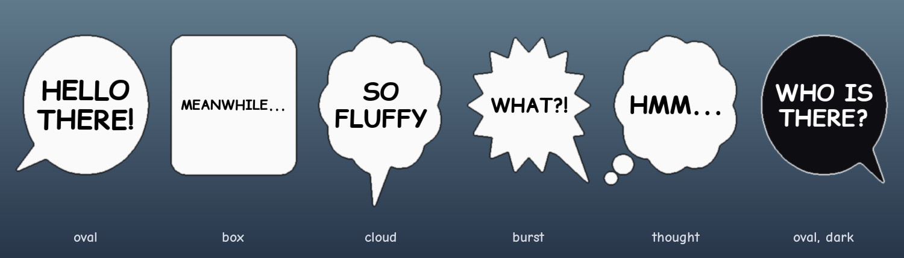
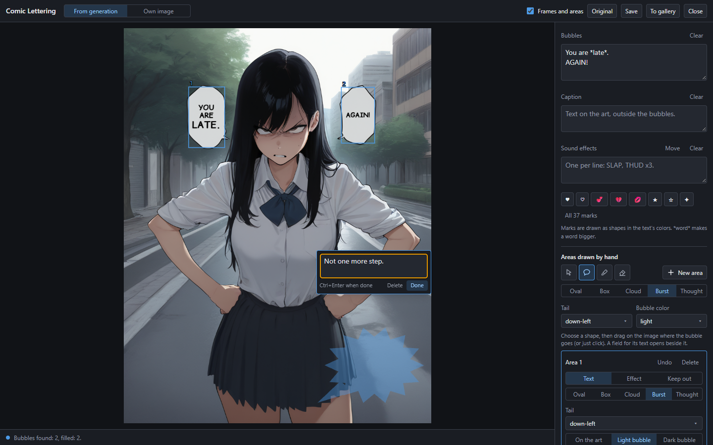
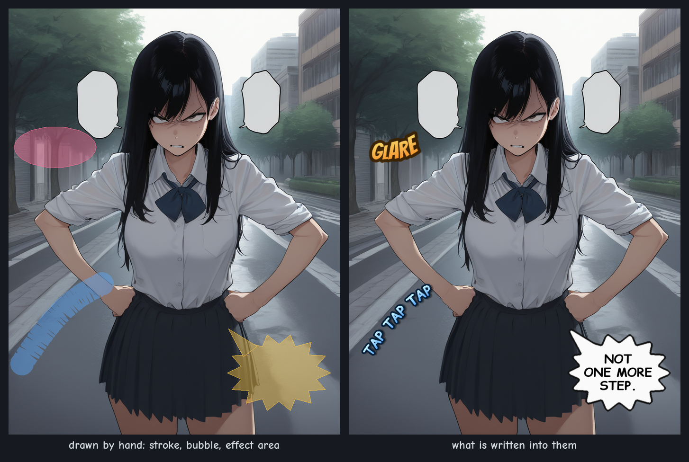
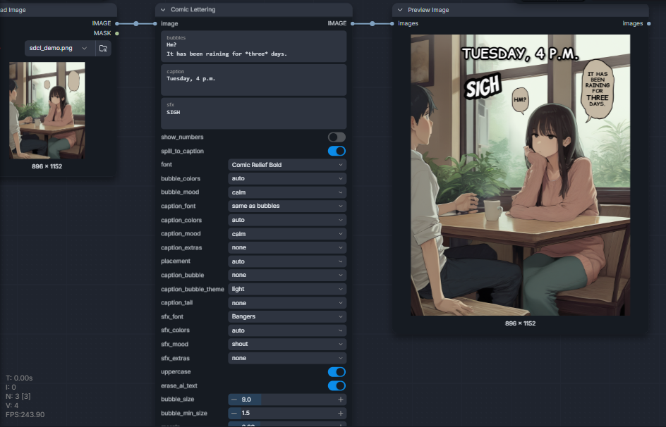
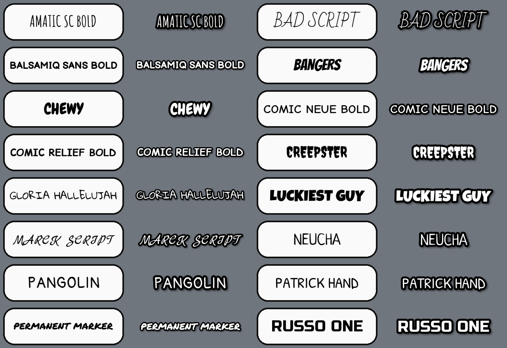

# Comic Lettering

**Put your own words on a generated image, without opening an image editor.**

Image models draw speech bubbles full of gibberish. Comic Lettering finds those bubbles, wipes them clean and fits your text inside. It also draws captions and sound effects straight onto the art, and lets you add bubbles of your own where the model drew none.

One repository, two hosts: an **extension for AUTOMATIC1111 / Forge / reForge** and a **custom node for ComfyUI**, with the same editor in both.



## Contents

- [What it does](#what-it-does)
- [Requirements](#requirements)
- [Install](#install)
- [Quick start](#quick-start)
- [The editor](#the-editor)
- [Writing the text](#writing-the-text)
- [The look](#the-look)
- [Placing things by hand](#placing-things-by-hand)
- [Bubbles and areas of your own](#bubbles-and-areas-of-your-own)
- [Saving](#saving)
- [Lettering every image automatically](#lettering-every-image-automatically)
- [Keeping text off the characters](#keeping-text-off-the-characters)
- [ComfyUI](#comfyui)
- [More settings](#more-settings)
- [Fonts](#fonts)
- [Limits](#limits)
- [Troubleshooting](#troubleshooting)
- [For developers](#for-developers)
- [License](#license)

## What it does

| | |
|---|---|
| **Fills the bubbles in the art** | Empty or gibberish bubbles are found, erased and filled, each line at the largest size that fits. |
| **Captions** | Text straight on the art with an outline and a shadow, or inside a bubble drawn for it. A free, calm spot is chosen automatically. |
| **Sound effects** | `STOMP`, `THUD x3`: big, tilted, outlined words placed in the empty parts of the picture. |
| **Bubbles of your own** | Five ready-made shapes with tails, or any shape you paint with a brush. |
| **Text along a line** | Paint one brush stroke and the words follow its curve. |
| **37 marks** | Hearts, stars, sparks, notes, anger marks and more, drawn as shapes so they work in every font. |
| **Hand placement** | Drag, resize and turn captions, effects and your own areas on the image. |
| **A look per kind of text** | Font, color preset, mood and decoration, separately for bubbles, captions and effects. |
| **Automatic mode** | Letter every image during generation, with no clicks at all. |

## Requirements

| | |
|---|---|
| Host | AUTOMATIC1111, Forge or reForge; or ComfyUI |
| Python packages | `numpy`, `scipy`, `Pillow` 9.2 or newer. Both hosts already ship them: nothing is installed. |
| Node.js | Not needed. The editor is shipped built. |
| Optional | `ultralytics` and a person segmentation model, so automatic placement keeps off the characters. See [Keeping text off the characters](#keeping-text-off-the-characters). |

## Install

**AUTOMATIC1111 / Forge / reForge.** Open `Extensions` → `Install from URL`, paste the address below and press `Install`. Then restart the web UI.

```
https://github.com/KazeKaze93/sd-comic-lettering
```

Or from a terminal:

```
cd extensions
git clone https://github.com/KazeKaze93/sd-comic-lettering.git
```

**ComfyUI.**

```
cd ComfyUI/custom_nodes
git clone https://github.com/KazeKaze93/sd-comic-lettering.git
```

Restart ComfyUI. The node is `Comic Lettering`, in the category `image/postprocessing`.

**Update** either one with `git pull` in the `sd-comic-lettering` folder, then restart the host and refresh the browser page.

## Quick start

For AUTOMATIC1111 / Forge / reForge. ComfyUI has [its own section](#comfyui).

1. Generate an image. Asking for `speech bubble` in the prompt gives the script bubbles to fill.
2. Press the **speech-bubble icon** in the row of small tool buttons under `Generate`. The editor opens over the page with the image from the gallery.

   

   The last icon in the picture is Style Grid's, shown when that extension is installed.
3. Type into `Bubbles`, one line per bubble. The number beside each line is the bubble it went into, the same number as on the image.
4. Press `To gallery` to put the result into the gallery, or `Save` to write it to disk.

Everything applies by itself: a list or a checkbox when it changes, a slider when you let go of it, a text field when you leave it or press Ctrl+Enter. There is no "Apply" button.



## The editor

The editor has four parts: the top bar, the tools at the left of the image, the image with the status line under it, and the panel at the right.

### Top bar

| Control | What it does |
|---|---|
| `From generation` / `Own image` | A list: which image is lettered. `From generation` is the one in the gallery of the tab you came from; `Own image` is a file of yours. Drop a file onto the editor or click to choose one; nothing has to be generated for that. |
| Undo, Redo | Take back the last change, or do it again: Ctrl+Z, and Ctrl+Shift+Z or Ctrl+Y. They cover the texts, the look, what was placed by hand and the areas, fifty steps back. Inside a text field the same keys undo typing, as in any text field. |
| `Frames and areas` (F) | An icon button. Shows or hides everything drawn over the image: the numbers and frames of the bubbles found, and the frames of captions, effects and areas. Switch it off to see the image exactly as it will be saved. |
| `Hold to compare` (C) | While the button or the key is held, the image is shown without the lettering. |
| `Auto on` / `Auto off` | Says whether [every new image is lettered by itself](#lettering-every-image-automatically); a click leads to the setting. Not in ComfyUI. |
| `Save` | Writes the lettered image to disk. See [Saving](#saving). |
| `To gallery` | Puts the lettered image into the host's gallery and closes the editor. Not in ComfyUI. |
| `Close` | Closes the editor. Esc does the same; in a text field the first Esc only leaves the field. |

### Tools

The tools stand in a rail at the left of the image. Each has a key.

| Tool | Key | What it does |
|---|---|---|
| Arrow | V | Draws nothing. Drag captions, effects and areas; click an area to change it. |
| Bubble | B | Puts a ready-made bubble on the image. |
| Brush | P | Paints an area of any shape. |
| Eraser | E | Rubs out what was painted. |
| New area | N | The next thing you draw starts a new area, even on top of the picked one. |

The keys go by their place on the keyboard, so they work in any layout. They do nothing while you type in a text field. The tools are described under [Bubbles and areas of your own](#bubbles-and-areas-of-your-own).

### The image

What stands over the image is colored by where it comes from:

| Color | What it marks |
|---|---|
| Blue | What the script found or placed: the bubbles in the art, and a caption or an effect at its automatic place. |
| Purple | What you placed or drew: a caption or an effect moved by hand, and every area. |
| Red | An area to keep clear. |
| Dashed amber frame | A bubble that was found and left empty. |

Every bubble found carries its number in a round badge. The status line under the image says how many bubbles were found and filled, and warns when character detection is off. Once something has been placed by hand, its right end says how many things, with `Place all automatically` to hand them all back to the script.

With no image to letter, the image area says what to do first.

### The panel

The panel is a column of sections that fold. A folded section says in a line what it holds.

| Section | What is in it |
|---|---|
| `Bubbles` | The text for the bubbles in the art, and its look. |
| `Caption` | The text outside the bubbles, and its look. |
| `Sound effects` | The effects, and their look. `Shuffle` in its header puts them somewhere else. |
| `Areas drawn by hand` | What the tool in hand will draw, and the areas drawn so far. |
| `All text` | What every kind of text shares. |
| `Automatic mode` | Lettering during generation. Not in ComfyUI. |

Each of the three text sections has its text field with a bar of marks on top, the lists of its look, and `More…` with the rest of its settings. A setting shared by several kinds of text says so in its label.



## Writing the text

There are three fields.

| Field | What goes in |
|---|---|
| **Bubbles** | One line per bubble, in reading order: top to bottom, left to right. An empty line leaves a bubble empty. Line breaks inside a bubble are chosen for you, at the largest font size that fits, with short lines at the top and bottom and long ones in the middle. To break the lines yourself, or to set the size for one bubble, see [Line breaks and a size of your own](#line-breaks-and-a-size-of-your-own-for-one-bubble). |
| **Caption** | Text outside the bubbles: straight on the art, or in a bubble drawn for it (`Put in a bubble` in the `Caption` section). |
| **Sound effects** | One per line. Each is drawn big, tilted and outlined in a calm, empty part of the art, clear of the bubbles, the characters, the caption and the other effects. `THUD x3` stacks the word three times in a ragged column. `Shuffle` sends them all somewhere else. |

A word may break after a hyphen you typed (`H-m-m`) when that lets the text be bigger.


### Line breaks and a size of your own, for one bubble

Two marks in a line of the `Bubbles` field change how that line is fitted into its bubble. Both are optional, and a line without them is fitted as before. They work the same in the editor, in automatic mode, in the ComfyUI node and on the command line.

| Mark | What it does | Example |
|---|---|---|
| `\|` | A line break inside the bubble, where you put it. The script keeps your lines as they are and takes the largest font at which all of them fit. | `Go on,\|ask nicely.\|I might flex ♥` |
| `[6]` at the start of the line | The largest font tried in this bubble, in % of image height: the unit of `Largest font, %`, which it replaces for this one bubble. `[6%]` and `[6.5]` are read too. | `[6]Go on, ask nicely.` |

The two go together: `[4]Go on,|ask nicely.|I might flex ♥`.

**Changed from earlier versions:** `|` in a line of the `Bubbles` field now breaks the line. Before, it was drawn as a character. A text of yours that has `|` in it will be lettered differently: the `|` is no longer drawn, and the line breaks where it stood. In the same way a line that starts with a number in square brackets, such as `[3] apples`, now reads the number as a size. Square brackets around anything else (`[sigh]`) are text, as before.

**When your breaks do not fit.** Lines broken by hand cannot be re-wrapped, so a long line between two breaks can make the font very small. If your lines do not fit at the smallest readable size (`Smallest font, %`), the breaks are dropped: the text is wrapped automatically, as if the `|` were spaces, and the status line says so (`Bubble 3: the line breaks typed with "|" do not fit…`). Automatic mode, the ComfyUI node and the command line write the same sentence to the console. To keep your breaks at any size, give the line a size of its own, as below.

**A size of your own is not second-guessed.** A line with `[…]` is always written into its bubble: it is not sent to the caption for being smaller than `Smallest font, %`, and its breaks are kept down to the smallest size the script draws at all (1.2% of image height). The size is a ceiling, not a promise: text that does not fit at that size is still made smaller.

A line that goes to the caption keeps its breaks. `|` and `[…]` mean something only in the `Bubbles` field; the caption and the text of an area take a line break as you type it.

### Which bubble a line went to

Beside every line of the `Bubbles` field stands a marker.

| Marker | Meaning |
|---|---|
| A number in a filled badge | The line went into the bubble with that number. |
| A number in a dashed, hollow badge | An empty line: it left that bubble empty. |
| `cap` | The line fitted no bubble and went to the caption. |
| `—` | The line went nowhere: there was no bubble left for it. |
| A number in a dashed gray badge | The text has changed since the image was drawn. Leave the field to draw it. |

The numbers are not always 1, 2, 3 in a row: a line that does not fit a bubble tries the next one.

**When a line does not fit.** A line goes into a bubble only if it fits at a readable size in at most eight lines. In a bubble too tight for an emphasised word, the emphasis is dropped first; then the longest words are broken with a hyphen (`UNBE-` / `LIEVABLE`). A line that still does not fit goes to the caption, and the next line gets that bubble. To always write into the bubbles, however small, switch off `Text too long for a bubble goes to the caption` under `Bubbles` › `More…`; lines left without a bubble are then dropped.

### Marks and bigger words

Every text field has a bar on top.

| On the bar | What it does |
|---|---|
| `A+` | Makes a word bigger by putting stars round it: `*word*`. It takes what you selected, or the word the caret is in. |
| Four marks | The marks you used last. A click puts one in at the caret. |
| `More` | Every mark, in four groups: Love, Shine, Feelings and weather, Signs. |
| `Clear` | Empties the field. |


Comic fonts have no hearts or stars, so marks are drawn as shapes, in the colors of the text they stand in. The buttons show the shapes that will be drawn. Typing the character works as well as pressing its button: `♥` (or `<3`) `♡` `💕` `💔` `💋` `★` `☆` `✦` `✨` `💥` `💢` `⚡` `🔥` `💧` `💦` `♨` `💨` `〃` `〰` `🌀` `💤` `♪` `♫` `✿` `🌙` `☀` `♂` `♀` `✖` `○` `→` `←` `↑` `↓` `♦` `♠` `♣`.

## The look

Bubbles, the caption and sound effects each have a look of their own, set in their own section.

| List | What it does |
|---|---|
| **Font** | Every entry of the list is shown in its own font. The caption can use the bubble font (`same as bubbles`) or one of its own. |
| **Colors** | A preset: fill, outline, and where it suits, a second outline, a gradient or a glow. `auto` is white with a dark outline (black inside a light bubble). `from the art` takes the strongest color of the image. `custom` uses colors of your own. |
| **Mood** | How unruly the letters are, from `calm` to `shaky`. `custom` uses sliders of your own. |
| **Marks around** | Small marks scattered around a caption or an effect. |






**Colors of your own.** With `Colors` set to `custom`, the section's `More…` shows its colors. Each has a swatch and a switch: `auto` leaves the color to the script, `pick…` opens the system's color picker. The text color is one setting for the bubbles and the caption, and its label says so.

**An outline for bubble text.** Text on a bubble can get an outline: `Outline width` in `Bubbles` › `More…`. It helps colored text stand out from the bubble.

**A mood of your own.** With `Mood` set to `custom`, the sliders appear under the list. There is one set of them: every kind of text set to `custom` follows it.

The caption has a few more lists:

| List | What it does |
|---|---|
| **Position** | `auto`, `top`, `bottom`, `center` or a corner. With `auto` the script tries a band at the top or bottom, then a block in a corner, then the same a little smaller, and takes the first that is clear of bubbles and characters. |
| **Put in a bubble** | Draws a bubble for the caption: `oval`, `box`, `cloud` or `burst`. |
| **Bubble color** | `light`: white with a dark outline. `dark`: black, with the outline and text in the chosen colors. |
| **Tail** | Which way the tail points, or none. |

The last two appear once a bubble shape is chosen.

## Placing things by hand

The caption, its drawn bubble and every sound effect can be moved on the image, with the Arrow tool.

- **Drag** a frame to move it.
- **Click** a frame to pick it. The square at a corner resizes it; the round knob on a stem turns it.
- **Arrow keys** nudge the picked item by one pixel, by ten with Shift.
- `Place automatically` beside a picked frame, or Delete, hands that item back to the script. `Place all automatically` in the status line does it for all of them.


A frame turns purple once you have placed it. Its handles stand where they can be reached: inside the visible part of the image area, and off the frames of other things, so the knob may be above, below or beside the frame.

What you placed stays where it is when the texts or the look change, and everything placed automatically keeps off it. Texts inside bubbles found in the art are always fitted by the script.

## Bubbles and areas of your own

When the model drew no bubble where you need one, make it yourself. An area is a place on the image that you mark out; text is fitted into it. The text of an area is typed in a field right on the image, and its settings are in the `Areas drawn by hand` section.

### Ready-made bubbles

Take the Bubble tool. While no area is picked, the section shows what the tool will draw: the shape, the `Tail` (eight directions, or none) and the `Bubble color`. Drag on the image where the bubble goes; a click alone puts down one of a handy size.



A field for the text opens beside the bubble. Type, then press `Done` or Ctrl+Enter: the bubble is painted and the text is fitted inside. The bubble becomes a row in the section.



### Painted areas

With the Brush, paint the place where text should go; the same field opens beside it. A slider sets the width, and a ring on the image shows it. Paint that touches the picked area adds to it. Paint anywhere else starts a new area, so two bubbles are two areas with a text each. `New area` starts one even on top of the picked one. The Eraser rubs out whatever it passes over, in every area.

**Text along a stroke.** An area made of a single brush stroke starts with `Write along the brush stroke` on: the words run along the stroke and bend with it, in the direction you drew it, with letters about as tall as the brush is wide. Paint one stroke along a contour to set a word on it. `Turn the text round` runs it the other way.


### The picked area and the others

Click an area with the Arrow, or click its row, to pick it. The field with its text opens on the image, with its own bar of marks; handles appear on the area; and its row in the section becomes a card with its settings.

| On the card | What it does |
|---|---|
| `Text` / `Effect` / `Keep out` | What the area is for. `Text`: the text is fitted in, as large as the shape allows. `Effect`: the text is one sound effect, sized to the area and put in its middle. `Keep out`: nothing the script places lands there; use it to protect a face or a detail. |
| Shape and `Tail` | For a ready-made bubble: its shape and tail can still be changed. |
| `On the art` / `Light bubble` / `Dark bubble` | For `Text`: draw it with the caption's outline, or paint the area as a bubble first, so that any shape you paint becomes a bubble. |
| `Write along the brush stroke`, `Turn the text round` | For an area with a brush stroke, see above. |
| `Size, %` | How large the text is against what the area gives it; above 100 it may reach out of the area. |
| `Tilt, °` | The tilt of the text. An effect is tilted at random until you set it. |
| `Undo stroke` | Takes back the last thing drawn in this area. |
| `Delete` | Removes the area. |
| `Done` | Finishes with the area: it becomes a row again. |

The corner square makes the area larger or smaller about its middle, the knob on the stem turns it, and the text inside turns and resizes with it. A drag moves the area with everything in it.


Every other area is one row: a swatch of its color, its number, what it is for, and the start of its text, with a button to delete it. The tool's own settings come back once no area is picked, so a bubble's shape is never on the panel twice.

An area's tint shows only while you work on it. Once it has its text and the field is closed, the tint goes; pointing at the area with the Arrow brings it back, and the Eraser shows every area.



Areas and everything placed by hand belong to the image they were made on. They stay when the editor is closed and opened again on the same image, and go with the next generation.

## Saving

- **`Save`** saves the lettered image the way the host saves its own images of that tab: same folder, file name pattern, numbering, format and subfolders, with `-lettered` at the end of the name and the generation parameters kept. The status line names the file.
- **`To gallery`** shows the result in the gallery of the tab you came from and closes the editor. From there the host's own buttons (save, send to img2img, send to extras) work on it as on any image.

The look is remembered between sessions in `user_settings.json` in the extension folder.

## Lettering every image automatically

Tick `Letter every new image while it is generated` in the `Automatic mode` section of the panel. The chip in the top bar says `Auto on` from then on, and every image a generation makes is lettered with the three texts and the look as they stand in the editor, and arrives in the gallery already lettered. The editor can still be opened on it: it works from the clean copy.

Areas and hand placement are not part of this mode: they belong to one image.

## Keeping text off the characters

Text that is placed automatically (sound effects, and the caption with `auto` position) avoids the characters when two things are present on the machine:

- the `ultralytics` Python package (ADetailer installs it), and
- a person segmentation model named `person_yolov8*-seg.pt`.

The model is looked for in `models/adetailer`, `models/ultralytics/segm`, a StabilityMatrix `Models/Ultralytics/segm` folder and a sibling ComfyUI install. The `SDCL_PERSON_MODEL` environment variable can point at any other file. **Nothing is downloaded.**

Without them the status line says so, and placement goes by calm areas alone, which often means on a character. Use a `Keep out` area or drag the item in that case.

## ComfyUI

Add the `Comic Lettering` node (category `image/postprocessing`) between `VAE Decode` and `Save Image`. Its widgets are the three texts and the whole look, and it letters every image that passes through it.



The node has the same editor, behind the `Open editor` button at the bottom of the node:

1. Run the workflow once, so the node has seen an image.
2. Press `Open editor`. The editor opens over ComfyUI with that image, as it came into the node.
3. Work as described above: texts, look, dragging, bubbles, areas.
4. Run the workflow again: it gives the picture the editor showed.


What differs from the web UI family:

| | |
|---|---|
| **The node is the memory** | Every change in the editor is written back into the node: texts and look into its widgets, hand placement and areas into a hidden `layout` field. The workflow file carries everything; `user_settings.json` is not used. |
| **`Save`** | Writes the picture into ComfyUI's output folder straight away, as `ComfyUI_lettered_00001_.png` and so on. |
| **No `To gallery`, no automatic mode** | The node letters every run by itself. `Save` is the main button of the top bar, and the `Auto` chip and the `Automatic mode` section are not there. |
| **Random seeds** | Hand placement and areas are kept as positions on the image: with a new seed the next image gets them in the same places. |
| **Batches** | The editor shows the first image; the layout goes onto all of them. |
| **`show_numbers`** | A node-only switch: draws each bubble's number instead of text, to see the reading order without opening the editor. |

## More settings

The settings that are needed less often are behind `More…` in each text section, and in `All text`. A label is short; pointing at it shows it in full.

**`Bubbles` › `More…`**

| Setting | What it does |
|---|---|
| `Erase the letters the model drew` | Wipes a bubble clean before writing. |
| `Text too long for a bubble goes to the caption` | See [When a line does not fit](#which-bubble-a-line-went-to). |
| `Largest font, %` | The largest font tried in a bubble, % of image height. |
| `Smallest font, %` | The smallest font still readable, % of image height. Below it a line counts as not fitting. |
| `Gap to the edge` | The space between the text and the bubble's edge. |
| `Darkest bubble fill` | The darkest fill still taken for a bubble, 0 to 255; 120 at the start. Raise it if a gray object gets lettered; lower it for dim bubbles. |
| `Outline width` | An outline around text on a bubble, as a share of the font size. 0, the start value, is no outline. One setting for the bubbles found in the art, bubbles of your own, painted areas with a bubble fill, and a caption put in a bubble. The text is fitted with its outline, so it stays inside the bubble. |
| `Outline color` | Shown once the width is above 0. `auto` is black on a light bubble and white on a dark one. A color of your own works with any `Colors` preset. |
| `Text color (shared with Caption)` | With `Colors` set to `custom`. |

**`Caption` › `More…`**

| Setting | What it does |
|---|---|
| `Font size, %` | The caption's font size, % of image height. |
| `Outline width` | The width of the caption's outline. |
| `Shadow` | The strength of the caption's shadow. |
| `Text color (shared with Bubbles)`, `Outline color` | With `Colors` set to `custom`. |

**`Sound effects` › `More…`**

| Setting | What it does |
|---|---|
| `Font size, %` | The effects' font size, % of image height. |
| `Largest tilt, °` | Effects tilt at random, up to this many degrees. |
| `Opacity` | How solid the effects are. |
| `Color` | With `Colors` set to `custom`. |

Where the effects land is not a number to set: `Shuffle` in the section's header arranges them differently, and Undo brings the last arrangement back.

**`All text`**

| Setting | What it does |
|---|---|
| `Capital letters` | Comic-style capitals. |
| `Soften edges, px` | Blurs the letter edges a little, which blends them with the art. |
| `Uneven ink` | Ink that is thinner in places, like a worn stamp. |
| `Bend into an arc` | Curves the lines up or down. |
| `Tilt, °` | Tilts all text. |
| `Opacity` | How solid all text is. |
| `Pattern`, `Try another` | One number picks the pattern of the letters' wobble, where the marks around a text fall, and the outline of the caption's drawn bubble. `Try another` takes the next one; the number is shown beside it. |
| `Reset the look` | Puts every setting of the look back. With `Keep the fonts` ticked, the three fonts stay. |

**`Custom mood (shared by all text)`**, under `Mood` when it is `custom`

| Setting | What it does |
|---|---|
| `Letters wobble` | Letters move off the line. |
| `Letter sizes vary` | Letters differ in size. |
| `Ragged edges` | Letter edges are torn. |
| `Lines tilt, °` | Each line tilts a little. |
| `Lines shift` | Lines move sideways. |
| `Line spacing` | The space between lines. |

## Fonts

Sixteen fonts ship in `fonts/bundled/`, taken from [google/fonts](https://github.com/google/fonts). Their licenses (SIL Open Font License 1.1 or Apache 2.0) are in `fonts/bundled/licenses/`.



Your own `.ttf` / `.otf` files go into `fonts/`: they are listed first and are git-ignored, so an update never touches them. A few comic-looking system fonts are listed last, when the system has them.

## Limits

- **What counts as a bubble.** A flat white, gray or lightly tinted (cream, beige) fill enclosed by a dark outline, or a flat near-black fill enclosed by a bright outline, with a smooth, nearly convex shape. Spiky or cloud-shaped bubbles, bubbles without an outline, translucent or gradient bubbles and rectangular caption boxes are not found. Use a ready-made bubble or a painted area for those.
- **False finds.** Anything that looks the same gets lettered too, such as a blank sheet of paper on a wall. The badges on the image number what was found: use an empty line to leave a number empty.
- **Narrow bubbles.** A narrow bubble cannot hold a long word at a readable size. Such text goes to the caption.
- **Crowded images.** When a character fills most of the frame there may be no free place. A drawn bubble is then tried tall and narrow, then shrunk, and put where it covers the least, keeping off heads and bubbles first. The head is taken to be the top quarter of a character, so this fails for a character lying down or upside down.
- **Fixed positions avoid nothing.** A caption set to `top` or a corner goes there whatever is underneath.
- **Sound effects.** A place is chosen for an estimated box, so a very wide font can make two effects touch.
- **No emoji font.** Only the 37 marks are drawn; any other emoji shows as the font's missing-character box.
- **One page at a time.** This is a lettering tool for single images, not a page layout tool: it does not make panels.

## Troubleshooting

| What you see | What to do |
|---|---|
| No speech-bubble icon under `Generate` | Restart the web UI after installing, then hard-refresh the page (Ctrl+F5). |
| `Nothing to letter yet` | The gallery of the tab is empty. Generate an image, or press `Letter your own image`. |
| `The image is gone from memory. Load it again.` | The server keeps the last six images. Close the editor and open it again on the image. |
| A bubble is not found | Lower `Darkest bubble fill` under `Bubbles` › `More…`, or put a ready-made bubble over it. |
| Something that is not a bubble gets text | Leave its line empty, or raise `Darkest bubble fill`. |
| Text lands on a character | See [Keeping text off the characters](#keeping-text-off-the-characters), or drag it, or paint a `Keep out` area. |
| A `Light bubble` area is not painted | An area is painted once it has text and the field is closed with `Done` or Ctrl+Enter. |
| The editor looks old after an update | Hard-refresh the page (Ctrl+F5). |
| A line of `Bubbles` shows `cap` or `—` | It fitted no bubble. Shorten it, lower `Smallest font, %`, give the line a size of its own (`[6]` at its start), or put a bubble of your own where it should go. |
| `the line breaks typed with "\|" do not fit` | Your lines would need a font below `Smallest font, %`, so the text was wrapped automatically. Break the longest line once more, or put a size at the start of the line (`[6]`) to keep the breaks at any size. |
| The marks on the bars are plain characters, some in color | The host was not restarted after the update: restart it. |
| ComfyUI: `The node has no image yet` | Run the workflow once first: the editor shows the image the node last received. |

## For developers

| Document | What is in it |
|---|---|
| [docs/ARCHITECTURE.md](docs/ARCHITECTURE.md) | The layers, the repository layout, how a render travels from a click to pixels. |
| [docs/CORE.md](docs/CORE.md) | The Python core: `letter()`, `arrange()`, `draw()`, the scene format, pins, regions, the CLI. |
| [docs/API.md](docs/API.md) | The HTTP routes and the messages between the host page and the editor. |
| [docs/DEVELOPMENT.md](docs/DEVELOPMENT.md) | Building the editor, running it without a host, conventions, how to add a mark, a color preset or an option. |

The core can be used on its own:

```python
from PIL import Image
from comic_lettering import Style, letter

image = Image.open("page.png")
result, info = letter(image, "Hi!\nYo.", caption="Last day of summer.", sfx="SPLASH",
                      style=Style(sfx_colors="ice"))
result.save("lettered.png")
```

Or from a terminal, in the repository folder:

```
python -m comic_lettering in.png out.png --text "Hi!\nYo." --caption "Last day of summer." --sfx SPLASH
```

In `--text`, `\n` goes to the next bubble, `|` breaks a line inside a bubble and `[6]` sets a bubble's size: `--text "Hi!\n[4]Go on,|ask nicely."`. Keep the quotes: a shell reads a bare `|` as a pipe.

## License

The code is licensed under the [GNU Affero General Public License v3.0](LICENSE).

The bundled fonts keep their own licenses (SIL Open Font License 1.1 or Apache 2.0), in `fonts/bundled/licenses/`. Images you letter with this tool are yours: the license covers the program, not its output.
