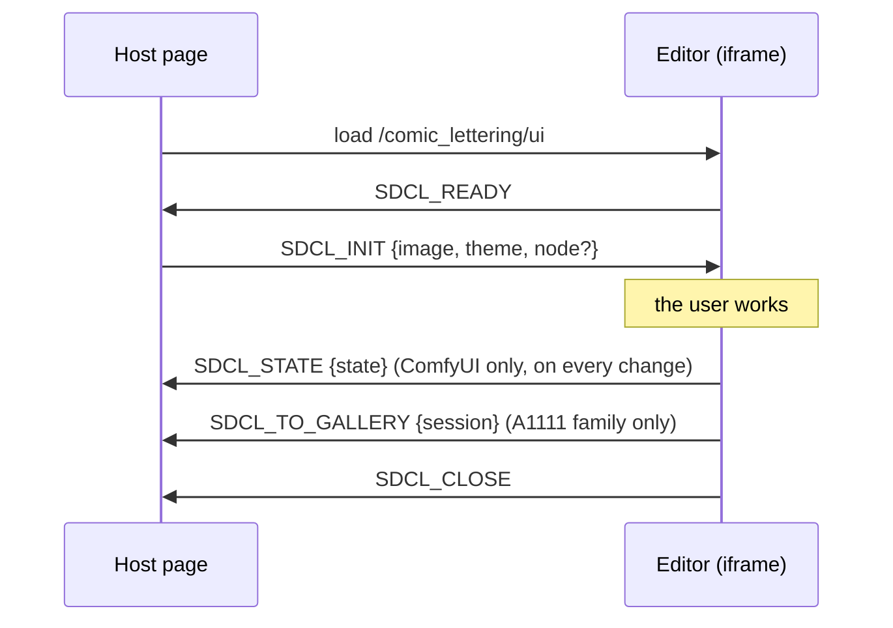

# HTTP routes and page messages

Two interfaces connect the parts:

- the **HTTP routes** between the editor page and the server (`comic_lettering/web.py`);
- the **`postMessage` types** between the host page and the editor page (`ui/src/bridge.ts`).

Both are the same in every host.

- [HTTP routes](#http-routes)
- [Settings object](#settings-object)
- [Messages between host page and editor](#messages-between-host-page-and-editor)
- [Writing another host](#writing-another-host)

## HTTP routes

All routes live under `/comic_lettering`. Bodies and answers are JSON unless noted. An error is `{"error": "<message>"}` with a 4xx or 5xx status; the page shows the message in its status line.

The routes have no authentication of their own: they are served by the host's server and are as reachable as the host is.

| Method | Route | Purpose |
|---|---|---|
| GET | `/ui` | The editor page (HTML) |
| GET | `/options` | Lists for the page, defaults and saved settings |
| GET | `/font?name=` | A font file, for the font list previews |
| POST | `/settings` | Save the look and the automatic mode |
| POST | `/session?name=` | Upload an image to letter |
| POST | `/session/last` | Start from an image of the last generation |
| POST | `/render` | Letter a session's image |
| GET | `/image/{session}/{which}` | The original or the lettered image, PNG |
| POST | `/save` | Save the lettered image through the host |
| GET | `/static/{path}` | ComfyUI only: the files of `ui/dist` |

### GET `/comic_lettering/ui`

The built `ui/dist/index.html` with every relative asset address rewritten to where the host serves the build from, and a fresh `?v=` on each, so a browser never shows an old build:

- A1111 family: `/file=extensions/<folder>/ui/dist/...` (the host's own file route);
- ComfyUI: `/comic_lettering/static/...`.

`500` with a short HTML message when `ui/dist` is missing.

### GET `/comic_lettering/options`

```json
{
  "fonts": ["Comic Relief Bold", "Amatic SC Bold", "..."],
  "sameFont": "same as bubbles",
  "palettes": ["auto", "black on white", "pink", "..."],
  "moods": ["calm", "playful", "shout", "shaky", "rough", "custom"],
  "extras": ["none", "hearts", "..."],
  "shapes": ["none", "oval", "box", "cloud", "burst"],
  "themes": ["light", "dark"],
  "tails": ["none", "down-left", "..."],
  "placements": ["auto", "top", "..."],
  "symbols": ["♥", "♡", "..."],
  "marks": [
    {"symbol": "♥", "name": "heart", "group": "Love", "mask": "data:image/png;base64,iVBORw0…"},
    "..."
  ],
  "defaults": { "...": "the settings object with default values" },
  "settings": { "...": "the settings object as saved" },
  "auto": {"enabled": false, "text": "", "caption": "", "sfx": ""}
}
```

`symbols` is the plain list of the characters that are drawn as shapes. `marks` is the same set with what a picker needs, in the order of the groups:

| Field | Meaning |
|---|---|
| `symbol` | The character to put into a text. |
| `name` | The name of its shape in the renderer (`render.SHAPES`). |
| `group` | Where the picker shows it: `Love`, `Shine`, `Feelings and weather` or `Signs` (`web.MARK_GROUPS`). |
| `mask` | The shape as a 48 by 48 PNG in a `data:` address: white where the shape is, clear elsewhere. |

The masks exist so that a mark's button shows what will be drawn. Several of the characters are color emoji, which a browser paints in its own colors and its own drawing; the renderer draws every mark as a flat shape in the color of the text. The mask is made by the renderer's own `symbol_tile()`, so the page can paint the exact shape in any color (`mask-image` goes by the alpha) and nothing has to be kept in step by hand. The list is built once per server run (about 25 ms) and adds about 58 KB to the answer.

A character that is in a group but has no shape is left out of `marks`, and the server says so on its error stream; the request never fails over it.

### GET `/comic_lettering/font?name=<display name>`

The font file, cached by the browser for a day. `404` for an unknown name. Only fonts known to `list_fonts()` can be fetched: the name is looked up, never used as a path.

### POST `/comic_lettering/settings`

```json
{"settings": { "...": "..." }, "auto": {"enabled": true, "text": "Hi", "caption": "", "sfx": ""}}
```

Writes `user_settings.json`. Values are cleaned first (`merge_values`): unknown keys are dropped, wrong types fall back to the default, list values must belong to their list. `auto` is optional; without it the saved one is kept. Answers `{"ok": true}`.

The ComfyUI page does not call this route: there the node holds the settings.

### POST `/comic_lettering/session?name=<file name>`

The body is the raw bytes of an image file (not JSON, not multipart).

```json
{"session": "5f0c…", "width": 896, "height": 1152}
```

`400` for an empty body or bytes that are not an image. A PNG's `parameters` text chunk (the generation parameters) is kept and written into the saved file.

### POST `/comic_lettering/session/last`

```json
{"tab": "txt2img", "index": 0, "count": 1, "known": "txt2img:7:0", "session": "5f0c…"}
```

| Field | Meaning |
|---|---|
| `tab` | `txt2img`, `img2img`, or `node:<id>` in ComfyUI |
| `index`, `count` | Which image the host's gallery shows, and how many it lists. A gallery with more images than were generated starts with their grid; the server subtracts the difference. |
| `known`, `session` | Optional: the origin and session the page already holds |

Answers either a new session:

```json
{"session": "9a1e…", "width": 896, "height": 1152, "origin": "txt2img:8:0"}
```

or, when `known` equals the current origin and the session is still alive:

```json
{"same": true, "origin": "txt2img:7:0"}
```

`404` `{"error": "no such image"}` when the tab has no such clean copy.

### POST `/comic_lettering/render`

```json
{
  "session": "9a1e…",
  "text": "Hi!\nYo.",
  "caption": "Later...",
  "sfx": "THUD",
  "settings": { "...": "..." },
  "pins": {"sfx:0": {"cx": 300, "cy": 700, "size": 60}},
  "regions": [{"id": "a", "kind": "text", "fill": "light", "text": "Hi", "shapes": []}]
}
```

`pins` and `regions` are as in [CORE.md](CORE.md#pins-placing-by-hand). The server also takes `numbers` (a boolean: draw each bubble's number instead of the texts); the editor does not send it. Answer:

```json
{
  "version": 3,
  "status": "Bubbles found: 2, filled: 2, plus a caption, sound effects: 1.",
  "warning": false,
  "empty": false,
  "info": { "...": "scene info" },
  "items": [ "... scene items ..." ],
  "bubbles": [[189, 171, 294, 348], [634, 172, 731, 335]]
}
```

`version` rises with every render; the page puts it into the image address. `warning` is true when the status says something the user should act on, such as character detection being off. `404` when the session is gone; `500` with the exception's name and message when the core fails.

### GET `/comic_lettering/image/{session}/{which}`

`which` is `original` or `result`. PNG bytes, encoded once per version. `result` falls back to the original when nothing is lettered.

### POST `/comic_lettering/save`

```json
{"session": "9a1e…", "tab": "txt2img"}
```

Answers `{"path": "<absolute path of the file>"}`. The file is written by the *saver* the host registered:

| Host | Where | Name |
|---|---|---|
| A1111 family | the host's output folder for that tab, with its subfolder rules | the host's pattern and numbering, suffix `-lettered`, the host's image format |
| ComfyUI | ComfyUI's output folder | `ComfyUI_lettered_00001_.png`, numbered like `Save Image` |
| none registered | `saved/` beside the package | `lettered-<date>-<time>-<name>.png` |

## Settings object

The look as the page and the server exchange it. Keys and defaults are `web.DEFAULTS`:

| Kind | Keys |
|---|---|
| Arguments of `arrange()` | `placement`, `spill`, `erase`, `white_threshold` |
| Fonts | `font`, `caption_font` (`"same as bubbles"` for the bubble font), `sfx_font` |
| Lists | `bubble_colors`, `caption_colors`, `sfx_colors`, `bubble_mood`, `caption_mood`, `sfx_mood`, `caption_extras`, `sfx_extras`, `caption_bubble`, `caption_bubble_theme`, `caption_tail` |
| Numbers | every numeric `Style` option, see [CORE.md](CORE.md#style) |
| Colors | `text_color`, `stroke_color`, `sfx_color` |
| Outline of text on a bubble fill | `bubble_stroke_width`: a fraction of the font size, `0` (the default) for no outline. `bubble_stroke_color`: `"auto"` or `#RRGGBB`; `auto` is black on a light bubble fill and white on a dark one |
| Switches | `uppercase` |

Everything except the four arguments of `arrange()` is copied onto a `Style` by `make_style()`.

## Messages between host page and editor

The editor runs in an `<iframe>` of the host page. Both have the same origin, and both sides drop any message whose origin or source is not the other.



**Host to editor**

| Type | Fields | Meaning |
|---|---|---|
| `SDCL_INIT` | `image: {tab, url, index, count}`, `theme: "dark" \| "light"`, `node?` | Sent after `SDCL_READY` and again each time the editor is opened. `image` says which gallery image is shown. `node` is present only in ComfyUI and switches the page into ComfyUI mode. |

`node` is `{texts: {text, caption, sfx}, settings, layout: {pins, regions}}`.

**Editor to host**

| Type | Fields | Meaning |
|---|---|---|
| `SDCL_READY` | none | The page has loaded its options and can take `SDCL_INIT`. |
| `SDCL_CLOSE` | none | Close the overlay (the `Close` button or Esc). |
| `SDCL_TO_GALLERY` | `session` | Put that session's lettered image into the host's gallery. |
| `SDCL_STATE` | `state` (the shape of `node` above) | ComfyUI mode: everything the page holds, to be written into the node. |

## Writing another host

A host needs three things:

1. **Routes.** Call `web.register(app, saver)` for a FastAPI app or `web.register_aiohttp(routes, saver)` for an aiohttp route table. For anything else, wire the `answer_*` functions yourself: each takes plain values and returns `(status, payload)`. Serve `ui/dist` somewhere and pass that base address to `ui_html(base)`.
2. **Images.** Before a generation call `web.begin_generation(tab)`; append each clean image to `web.LAST_CLEAN[tab]`. Without this the editor still works on `Own image`.
3. **A page script** that opens `/comic_lettering/ui` in an iframe, answers `SDCL_READY` with `SDCL_INIT`, and closes on `SDCL_CLOSE`.

`saver(image, parameters, tab)` saves a `PIL.Image` the way the host saves its own and returns the path. `parameters` is the source image's generation text, or `None`.
