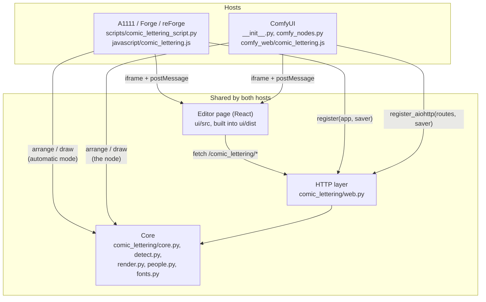
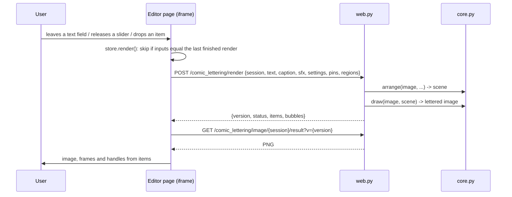

# Architecture

Comic Lettering is one core with two thin host layers on top and one editor page shared by both.

- [The layers](#the-layers)
- [Repository layout](#repository-layout)
- [The life of a render](#the-life-of-a-render)
- [Where state lives](#where-state-lives)
- [Host layer: AUTOMATIC1111 / Forge / reForge](#host-layer-automatic1111--forge--reforge)
- [Host layer: ComfyUI](#host-layer-comfyui)
- [The editor page](#the-editor-page)
- [Design decisions](#design-decisions)

## The layers



| Layer | Depends on | Knows nothing about |
|---|---|---|
| **Core** | `numpy`, `scipy`, `Pillow`; optionally `ultralytics` | HTTP, any host, the editor |
| **HTTP layer** | the core | which host serves it: every route is a framework-free `answer_*` function, registered once for FastAPI and once for aiohttp |
| **Editor page** | the HTTP routes and five `postMessage` types | which host it runs in, apart from one flag (`comfy`) |
| **Host layers** | their host's extension API | each other |

The rule that keeps it this way: **the core never imports `web`, and nothing in `comic_lettering/` imports a host module.** A host module is imported only inside a function that a host calls.

## Repository layout

```
sd-comic-lettering/
├── comic_lettering/            the core package (host-independent)
│   ├── core.py                 letter(), arrange(), draw(); placement of every kind of text
│   ├── detect.py               finding bubbles, erasing letters, edge energy
│   ├── render.py               fonts to pixels: layout, marks, palettes, moods, bubble shapes
│   ├── people.py               optional character mask (ultralytics)
│   ├── fonts.py                font discovery: fonts/, fonts/bundled/, system fonts
│   ├── web.py                  settings, sessions and the HTTP routes
│   └── __main__.py             CLI
├── scripts/comic_lettering_script.py   A1111 family: routes, clean copies, automatic mode
├── javascript/comic_lettering.js       A1111 family: tool icon, overlay iframe (ES5)
├── style.css                           A1111 family: sizes the icon, hides one row
├── __init__.py                 ComfyUI: entry point, routes, saving
├── comfy_nodes.py              ComfyUI: the Comic Lettering node
├── comfy_web/comic_lettering.js        ComfyUI: Open editor button, widget sync
├── ui/                         the editor: Vite + React 19 + TypeScript + Zustand + Tailwind
│   ├── src/                    sources
│   └── dist/                   the build, committed
├── fonts/                      user fonts (git-ignored) and fonts/bundled/ (shipped)
├── docs/                       this documentation
└── requirements.txt            numpy, scipy, Pillow
```

Both hosts load the same folder. A1111-family hosts run `scripts/*.py` and load `javascript/*.js` and `style.css`; they never import the root `__init__.py`. ComfyUI imports the root `__init__.py` and never looks into `scripts/`.

## The life of a render

What happens between a keystroke in the editor and new pixels on screen:



The core works in two steps on purpose:

- **`arrange()`** decides what goes where and returns a *scene*: a JSON-clean dict with every item's text, font size and place in pixels. It draws nothing.
- **`draw()`** turns a scene into pixels.

The editor needs the scene, not only the picture: frames, handles and the ghost preview while dragging are built from `scene["items"]`. See [CORE.md](CORE.md#the-scene).

Bubble detection is the slowest step, and both `arrange()` and `draw()` need it, on every change made in the editor. `detect_bubbles()` therefore keeps the result for the last six images, keyed by a hash of the pixels.

## Where state lives

| State | A1111 family | ComfyUI |
|---|---|---|
| The look (fonts, colors, sliders) | `user_settings.json` in the extension folder, written by `POST /settings` | the node's widgets, so the workflow file |
| The three texts | page memory; `user_settings.json` (`_auto` block) only while automatic mode is on | the node's widgets |
| Hand placement (`pins`) and areas (`regions`) | page memory, per image; forgotten with the next generation | the node's hidden `layout` widget, as JSON |
| Images being lettered | server memory: `web._sessions`, the last 6 | the same |
| Clean copies of the last generation | server memory: `web.LAST_CLEAN[tab]` | `web.LAST_CLEAN["node:<id>"]`, the first frame the node saw |

Nothing but `user_settings.json` and saved images is ever written to disk.

**Sessions.** A session is one image held in server memory under a random id, with its lettered result and cached PNG bytes. The page refers to images only by session id. Six are kept; the least recently used goes first. A page that asks for a dropped session gets `404` with *"The image is gone from memory. Load it again."*

**Which image is it.** When the editor opens, the page asks `POST /session/last` with the tab and the index of the image in the host's gallery. The server answers with an `origin` string, `"<tab>:<generation>:<index>"`. The page sends the origin it already holds back as `known`; if it matches and the session is still alive, the server answers `{"same": true}` and the page keeps its slot, with every pin and area in it. A new generation raises the counter, so everything belonging to the old image is dropped.

## Host layer: AUTOMATIC1111 / Forge / reForge

**`scripts/comic_lettering_script.py`** is an always-on script (`scripts.AlwaysVisible`).

| Hook | What it does |
|---|---|
| `script_callbacks.on_app_started` | `web.register(app, save_like_host)`: adds the routes to the host's FastAPI app |
| `ui()` / `before_component` | Places one hidden Gradio row per tab, `comic_lettering_bar_{tab}`, holding a hidden textbox and the hidden button `comic_lettering_to_gallery_{tab}` |
| `process()` | `web.begin_generation(tab)`: forgets the previous generation's clean copies |
| `postprocess_image()` | Stores a clean copy of the image in `web.LAST_CLEAN[tab]`; when automatic mode is on, letters `pp.image` in place |

`save_like_host()` saves through the host's own `modules.images.save_image`, so the folder, file name pattern, numbering, format and subfolders are the host's, with the suffix `-lettered` and the source image's generation parameters.

On "Reload UI" the host runs the script again but keeps imported packages. The script deletes `comic_lettering*` from `sys.modules` first, so a reload also picks up changes in the core.

**`javascript/comic_lettering.js`** runs in the Gradio page. It is written in ES5 style (no arrow functions, no template literals), like the host's own scripts.

- It adds a tool button to the row under `Generate` in txt2img and img2img, just before Style Grid's button when that extension is present. `dress()` copies the classes and the computed look of a tool button the host made itself, so the icon matches any theme.
- A click builds a full-screen overlay with an `<iframe src="/comic_lettering/ui">` and tells the page which gallery image is shown.
- On `SDCL_TO_GALLERY` it keeps the session id in `window.sdclSession` and clicks the hidden button, whose `_js` hands that id to Python; the Python side returns the lettered image into the gallery.

Gradio is used for exactly two things: the hidden "to gallery" round trip and the host's own tool-button look. Everything else is the iframe.

## Host layer: ComfyUI

**`__init__.py`** exports the node mappings, sets `WEB_DIRECTORY = "./comfy_web"` and, when a `PromptServer` exists, calls `web.register_aiohttp(PromptServer.instance.routes, save_like_comfy)`.

The page's files are served by a route of their own, `/comic_lettering/static/`, and are deliberately **not** inside `WEB_DIRECTORY`: ComfyUI loads every `.js` file in that folder as an extension script and would run the editor's bundle on its own page.

**`comfy_nodes.py`** defines `ComicLettering`: 49 required inputs (the three texts and the look), the optional `layout` string and the hidden `unique_id`. On each run it:

1. stores the first frame under the tab name `node:<unique_id>`, so the editor can fetch it;
2. reads pins and regions from `layout`;
3. runs `arrange()` + `draw()` on every frame of the batch.

**`comfy_web/comic_lettering.js`** adds the `Open editor` button to the node, hides the `layout` widget, and keeps the node and the page in step:

- on opening it sends `SDCL_INIT` with `node: {texts, settings, layout}` read from the widgets;
- on every `SDCL_STATE` from the page it writes the values back into the widgets.

Two options are named differently on the two sides (`spill` ↔ `spill_to_caption`, `erase` ↔ `erase_ai_text`); the script maps them.

## The editor page

Vite + React 19 + TypeScript + Zustand + Tailwind, with its own `cl-*` color tokens. Three runtime dependencies: `react`, `react-dom`, `zustand`.

| File | Role |
|---|---|
| `main.tsx`, `App.tsx` | Mounting; top bar, status line, the `SDCL_INIT` listener |
| `store.ts` | The whole state and every action (Zustand): slots per source, texts, settings, pins, regions, tools, rendering |
| `api.ts` | `fetch` wrappers for the routes |
| `bridge.ts` | `postMessage` to and from the host page |
| `types.ts` | `Settings`, `SceneItem`, `Region`, `Shape`, `Pin`, `Slot`, ... |
| `geometry.ts` | Bubble templates as polygons, bounding boxes, rotation |
| `components/Canvas.tsx` | The image, frames of found bubbles, areas, the drawing layer, handles, the text field beside an area |
| `components/SidePanel.tsx` | Text fields, marks, drawing tools, area cards, look, fine tuning |
| `components/controls.tsx` | `Button`, `Segmented`, `Select`, `Slider`, `Toggle`, `TextInput`, `Label` |

**Slots.** The store keeps one slot per source (`generation`, `own`): the session id, the image size, the last scene's items and bubbles, pins and regions. Switching the source switches the slot; nothing is lost.

**Rendering is debounced by equality, not by time.** `render()` serialises its inputs and returns at once when they equal the inputs of the last finished render (`slot.applied`).

**Dragging does not wait for the server.** While an item is dragged, the page moves a cut-out of the current picture along with the pointer (the *ghost*). The exact picture replaces it when the render comes back.

**Templates are geometry on the client.** A ready-made bubble is stored as a region whose `shapes` are polygons computed by `geometry.ts`, plus a `template` field (shape, tail, box, angle) so the card can still change it. The server sees only polygons.

## Design decisions

**Why an iframe.** The editor is a normal web page with its own CSS and bundle. An iframe keeps Gradio's styles out and ours in, and the same page drops into ComfyUI unchanged. Both sides share an origin, so `postMessage` is checked against `window.location.origin`.

**Why `ui/dist` is committed.** Extensions are installed with `git clone`; users have no Node. The build is part of the repository so that cloning is installing.

**Why the scene is JSON.** The scene crosses the HTTP boundary and, in ComfyUI, the positions set by hand live in a workflow file. Keeping every value a plain number, string or list means it can be stored and replayed anywhere.

**Why detection is classical.** Bubbles are found with thresholds, connected components and shape tests (`scipy.ndimage`), not a model: no download, no GPU memory, the same result everywhere. The price is in [the limits](../README.md#limits).

**Why nothing is downloaded.** Character detection uses a model only if one is already on the machine. An extension that fetches weights at start-up is an extension that breaks offline.
